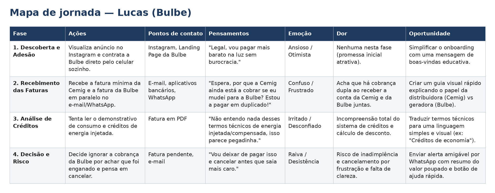

# Mapa de jornada do usuário

> Entregável da aula 19. Substitua os textos entre colchetes.

## Persona

- **Nome e idade:** Maria, 35 anos
- **Contexto:** Maria é assistente financeira e mora em Betim (MG) com o marido. Ela aderiu à Bulbe por indicação de uma amiga, buscando economizar na conta de luz, mas, após a contratação, ficou confusa sobre as etapas do processo. Ela não sabe quanto tempo precisa esperar, em que momento a fatura da Bulbe estará disponível e o que deve fazer enquanto aguarda. Como continua recebendo a conta da Cemig, fica insegura sobre como funciona a transição e se realmente está economizando e não sofrendo um golpe. A falta de atualizações claras aumenta sua ansiedade e faz com que pense em entrar em contato com o atendimento para entender o que está acontecendo.
- **Objetivo:** Acompanhar o processo de adesão de forma simples e rápida, sabendo em qual etapa está, o que acontecerá em seguida e se precisa tomar alguma ação. Maria quer ter segurança de que está tudo certo, sem precisar procurar informações em diferentes canais ou entrar em contato com o atendimento.
- **Medos e dúvidas:** Maria teme que sua adesão não tenha sido concluída corretamente ou que exista algum problema com sua conta. Tem dúvidas sobre por que ainda recebe a cobrança da Cemig, quando a fatura da Bulbe estará disponível e quando começará a perceber a economia. Também fica insegura quando não recebe mensagens de atualização e não sabe se precisa fazer alguma coisa ou apenas esperar.
Canais que usa: WhatsApp, Google, e-mail e aplicativo da Bulbe
- **Canais que usa:** WhatsApp, Google, e-mail e aplicativo da Bulbe.

## Mapa

| Fase | Ações | Pontos de contato | Pensamentos | Emoção | Dor (com evidência da Bulbe) | Oportunidade |
| --- | --- | --- | --- | --- | --- | --- |
| Contratação e configuração dos dados | A Maria contrata pelo site e confirma os dados | Site, e-mail, aplicativo ou WhatsApp | "Fiz tudo certo? | Expectativa e insegurança | Não sabe quais são as próximas etapas | Mostrar as etaps do proceso e disponibilizar a confimação de cada etapa. |

## Oportunidades registradas como Issues

- [ ] #10 Mostar as etapas do processo e disponibilizar a confirmação de cada  etapa.
