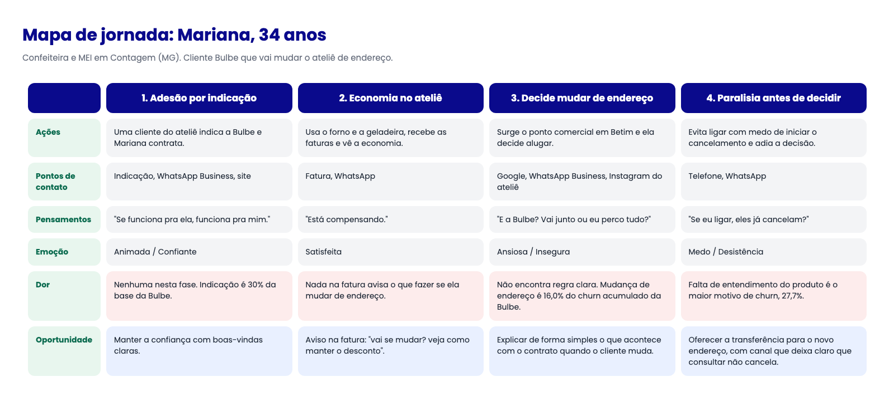

# Mapa de jornada do usuário

> Entregável da aula 19. Substitua os textos entre colchetes.

## Persona

- **Nome e idade:** Mariana, 34 anos
- **Contexto:** Mariana é confeiteira, MEI, e toca um ateliê de bolos dentro de casa no bairro Eldorado, em Contagem (MG). O forno elétrico e a geladeira industrial pesam na conta de luz. Ela aderiu à Bulbe por indicação de uma cliente do ateliê, animada com a promessa de desconto e com a ideia de sobrar caixa no fim do mês. Nos primeiros meses tudo correu bem: a economia apareceu e ela passou a confiar. Aí surgiu a chance de alugar um ponto comercial em Betim, e Mariana decidiu mudar o ateliê de endereço. Ela não faz ideia do que acontece com o contrato da Bulbe nessa mudança. Procurou no Google, achou conteúdo genérico e ficou sem resposta. Com a mudança marcada, o prazo apertou e ela começou a achar que o mais provável é ter que cancelar e recomeçar do zero.
- **Objetivo:** Continuar economizando na conta de luz no novo endereço do ateliê, sem cancelar nem ficar sem desconto durante a mudança. Quer saber, antes de assinar o aluguel, se o contrato vai junto, o que precisa fazer e quanto tempo leva até a economia voltar a aparecer.
- **Medos e dúvidas:** Não sabe se mudar de endereço conta como cancelamento ou como simples troca de titularidade, e ninguém nunca explicou isso. Teme que ligar para a Bulbe só para tirar a dúvida já inicie o cancelamento sem ela querer, e por isso evita o contato. Tem medo de ficar um período sem desconto e pagar a conta cheia no ateliê novo, onde o forno e a geladeira vão estar ligados desde o primeiro dia. Não sabe se o novo endereço, no ponto comercial, pode receber a economia, nem se precisa de documentos novos ou de uma nova análise. Como é MEI, também fica em dúvida se a mudança de endereço do CNPJ interfere no contrato. No fundo, tem medo de perder o que já conquistou com a Bulbe por falta de informação.
- **Canais que usa:** WhatsApp Business, Google, Instagram do ateliê, e atendimento por telefone quando o assunto é "dinheiro sério".

## Mapa

| Fase | Ações | Pontos de contato | Pensamentos | Emoção | Dor (com evidência da Bulbe) | Oportunidade |
| --- | --- | --- | --- | --- | --- | --- |
| 1. Adesão por indicação | Uma cliente do ateliê indica a Bulbe e Mariana contrata. | Indicação, WhatsApp Business, site | "Se funciona pra ela, funciona pra mim." | Animada / Confiante | Nenhuma nesta fase. Indicação é 30% da base da Bulbe. | Manter a confiança com boas-vindas claras. |
| 2. Economia no ateliê | Usa o forno e a geladeira, recebe as faturas e vê a economia. | Fatura, WhatsApp | "Está compensando." | Satisfeita | Nada na fatura avisa o que fazer se ela mudar de endereço. | Incluir na fatura um aviso "vai se mudar? veja como manter o desconto". |
| 3. Decide mudar de endereço | Surge o ponto comercial em Betim e ela decide alugar. | Google, WhatsApp Business, Instagram do ateliê | "E a Bulbe? Vai junto ou eu perco tudo?" | Ansiosa / Insegura | Não encontra regra clara sobre mudança de endereço. Mudança de endereço é 16,0% do churn acumulado da Bulbe. | Explicar de forma simples o que acontece com o contrato quando o cliente muda. |
| 4. Paralisia antes de decidir | Evita ligar com medo de iniciar o cancelamento e adia a decisão. | Telefone, WhatsApp | "Se eu ligar, eles já cancelam?" | Medo / Desistência | Falta de entendimento do produto é o maior motivo de churn, 27,7%. | Oferecer a transferência do contrato para o novo endereço, com um canal que deixa claro que consultar não cancela. |

## Oportunidades registradas como Issues

- [x] #12 Explicar e facilitar a mudança de endereço sem cancelar o contrato
