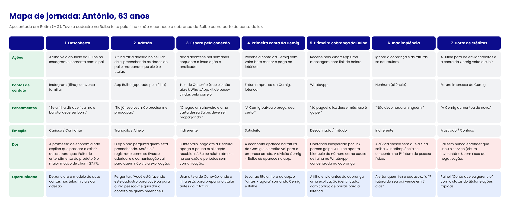

# Mapa de jornada do usuário

> Entregável da aula 19.

## Persona

- **Nome e idade:** Antônio, 63 anos
- **Contexto:** Aposentado, mora em Betim (MG) com a esposa e é quem paga as contas da casa (a da Cemig, na lotérica). A filha, que mora em BH, viu a Bulbe no Instagram e fez a adesão pelo app no celular dele, preenchendo nome, WhatsApp e CPF do pai como se fosse ele. Explicou por alto que "a conta de luz ia ficar mais barata". Antônio concordou sem entender o que estava contratando: para ele, a própria Cemig passaria a cobrar menos.
- **Objetivo:** Pagar as contas da casa em dia, sem surpresas e sem cair em golpe. Quer entender, em linguagem simples, por que agora são duas contas, quanto paga de luz no total e ter certeza de que a cobrança é legítima.
- **Medos e dúvidas:** Acha que o desconto veio da Cemig. Não sabe que tem um contrato ativo nem que deixar de pagar gera dívida. Interpreta a cobrança da Bulbe como golpe. Tem dificuldade com link e Pix e prefere boleto impresso ou lotérica. Depende da filha para tirar dúvidas.
- **Canais que usa:** WhatsApp (principalmente família), ligação telefônica, TV aberta e lotérica. Quase não usa aplicativos: o app da Bulbe só foi aberto pela filha, no dia do cadastro. Ela é a ponte entre ele e a empresa.

## Mapa

| Fase | Ações | Pontos de contato | Pensamentos | Emoção | Dor (com evidência da Bulbe) | Oportunidade |
| --- | --- | --- | --- | --- | --- | --- |
| 1. Descoberta | A filha vê o anúncio da Bulbe no Instagram e comenta com o pai | Instagram (filha), conversa familiar | "Se a filha diz que fica mais barato, deve ser bom" | Curioso, confiante | A promessa de economia na conta de luz não explica que passam a existir duas cobranças. **Evidência:** a falta de entendimento do produto aparece como o principal motivo de churn no histórico da empresa | Deixar claro o modelo de duas contas nas telas inicias da adesão |
| 2. Adesão | A filha faz a adesão no celular dele, preenchendo os dados do pai em Contato e marcando que ele é o titular da conta de luz | App Bulbe (operado pela filha) | "Ela já resolveu, não preciso me preocupar" | Tranquilo, alheio | O fluxo pergunta se quem adere é **titular da conta de luz** (e tem o caminho "Não titular"), mas não pergunta **quem está preenchendo**. Quando a filha usa os dados do pai, o app registra Antônio como se ele mesmo tivesse aderido, e toda a comunicação vai para quem não viu a explicação. **Evidência:** análise do fluxo atual de adesão (Contato → Negócio → Termo) | Perguntar em Contato: "Você está fazendo este cadastro para você ou para outra pessoa?" e guardar o contato de quem preencheu |
| 3. Espera pela conexão | Nada acontece por semanas enquanto a instalação é analisada | Tela de Conexão do app (que ele não abre), mensagens de onboarding por WhatsApp, kit de boas-vindas pelo correio | "Chegou um chaveiro e uma carta dessa Bulbe, deve ser propaganda" | Indiferente | O intervalo longo entre a adesão e a 1ª fatura apaga a pouca explicação que ele recebeu. **Evidência:** a empresa relata atrasos na conexão e períodos sem comunicação na régua de onboarding; o kit físico de boas-vindas (carta, chaveiro, cartão) chega após a qualificação, mas não é ligado à conta de luz | Usar a tela de Conexão, onde a filha está, para preparar o titular antes da 1ª fatura |
| 4. Primeira conta da Cemig | Recebe a conta da Cemig com valor bem menor e paga na lotérica | Fatura impressa da Cemig, lotérica | "A Cemig baixou o preço, deu certo" | Satisfeito | A economia aparece na fatura da Cemig, e o crédito vai para a empresa errada. O "Desconto Bulbe" e a divisão Cemig × Bulbe aparecem principalmente no app e na fatura Bulbe, que ele ainda não viu, e a explicação do desconto na tela de Conexão é um link externo. **Evidência:** telas de Conexão, Faturas e Ver detalhes do app | Levar ao titular, fora do app, o "antes × agora" somando Cemig e Bulbe |
| 5. Primeira cobrança da Bulbe | Recebe pelo WhatsApp uma mensagem com link de boleto | WhatsApp | "Já paguei a luz desse mês. Isso é golpe" | Desconfiado, irritado | Uma cobrança inesperada por link parece golpe para um público pouco digital, e a reação é ignorar ou bloquear. **Evidência:** a empresa aponta falhas relevantes na entrega de mensagens por WhatsApp, com bloqueio do número como uma das principais causas, concentrado na régua de cobrança, e reconhece que alinhar a expectativa antes do primeiro vencimento reduz a inadimplência | A filha envia antes da 1ª cobrança um kit de explicação identificado (nome, endereço, valores) com a fatura e o código de barras para pagar na lotérica |
| 6. Inadimplência | Ignora a cobrança; as faturas se acumulam | Nenhum (silêncio) | "Não devo nada a ninguém" | Indiferente | A dívida cresce sem que ninguém da família saiba, porque a filha não recebe nada. **Evidência:** a inadimplência se concentra na 1ª fatura de pessoa física e é muito maior que a da carteira madura; segundo a empresa, quem faz o primeiro acesso ao app paga bem mais do que quem não faz | Alertar quem fez o cadastro: "a 1ª fatura do seu pai vence em 3 dias e ainda não foi paga" |
| 7. Corte de créditos | A Bulbe para de enviar créditos e a conta da Cemig volta a subir | Fatura impressa da Cemig | "A Cemig aumentou de novo" | Frustrado, confuso | O cliente sai sem nunca entender que usou o serviço (churn involuntário), com risco de cobrança e negativação. **Evidência:** o churn da primeira safra é muito superior ao das seguintes, e falta de entendimento do produto e inadimplência são os dois principais motivos de churn | Painel "Conta que eu gerencio" com status do titular e ações: reenviar explicação, pagar por ele, falar com o atendimento |

## Oportunidades registradas como Issues

- [ ] #[número] Explicar nas telas iniciais da adesão que a economia vem em duas contas (Cemig + Bulbe)
- [ ] #[número] Perguntar na etapa Contato se a adesão está sendo feita para outra pessoa e guardar o contato de quem preencheu
- [ ] #[número] Card na tela de Conexão para enviar ao titular pelo WhatsApp, no mesmo formato do "Indicar por WhatsApp", a explicação das duas contas e o "antes × agora"
- [ ] #[número] Compartilhar com o titular a 1ª fatura Bulbe com código de barras, para pagamento na lotérica
- [ ] #[número] Notificar quem fez o cadastro quando a 1ª fatura do titular estiver perto do vencimento sem pagamento
- [ ] #[número] Painel "Conta que eu gerencio" no seletor de instalações, com status de pagamento do titular